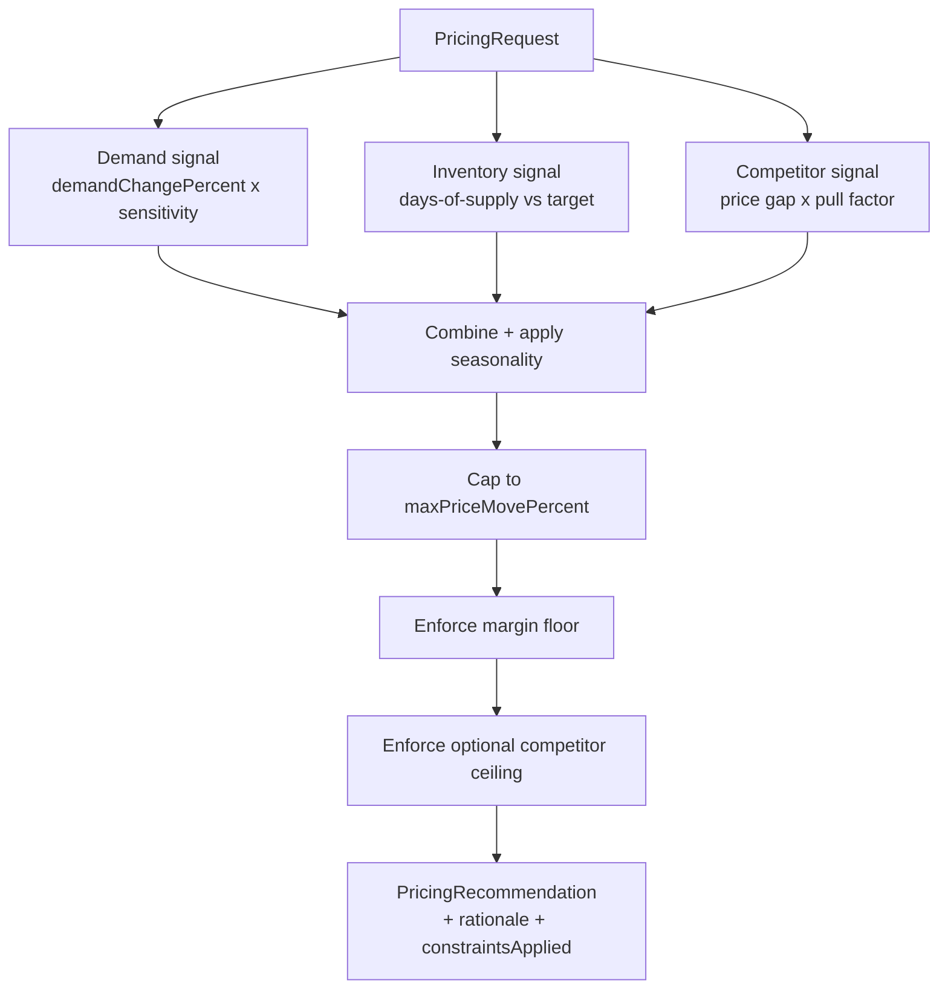

# Architecture

## Pipeline



### ASCII fallback

```
PricingRequest
   |-- demand signal      (demandChangePercent x DEMAND_SENSITIVITY)
   |-- inventory signal   (days-of-supply vs TARGET_DAYS_OF_SUPPLY, continuous)
   '-- competitor signal  (price gap x COMPETITIVE_PULL)
        |
        v
   combine + apply seasonalityFactor
        |
        v
   cap to +/- maxPriceMovePercent   (constraintsApplied, if triggered)
        |
        v
   enforce margin floor (costPrice x (1 + minMarginPercent))
        |
        v
   enforce optional competitor ceiling
        |
        v
   PricingRecommendation (price, %change, expected revenue/units change,
                           inventory risk, rationale, constraintsApplied)
```

## Components

| Component | Responsibility |
|---|---|
| `PricingEngine` | The rule set itself — the only place any coefficient lives |
| `WhatIfService` | Applies named overrides to a baseline request and compares recommendations |
| `PricingController` | `POST /api/pricing/recommend`, `POST /api/pricing/what-if` |

## Important Interfaces

- There is no separate "what-if" code path. `WhatIfService.compare()`
  builds a modified `PricingRequest` via `PricingRequest.with(...)` and
  calls the exact same `PricingEngine.recommend()` used for a normal
  request — a what-if scenario is just another call with different inputs.
- `PricingRecommendation.rationale` and `.constraintsApplied` are built
  alongside the calculation itself, not reconstructed afterward — every
  number in the rationale is read directly from the variable that produced it.

## External Dependencies

- Spring Web, Spring Validation (runtime)
- Spring Boot Test (JUnit 5, AssertJ — test scope only)
- No database, no external pricing/ML service — deliberately deterministic
  (see docs/design-decisions.md)

## Decision Points

- **Continuous inventory adjustment, not bucketed.** An earlier design used
  discrete bands ("<7 days: +6%, <14 days: +3%, ..."); it was replaced with
  a continuous function during verification specifically because it made
  what-if inventory comparisons unresponsive whenever two scenarios landed
  in the same band. See docs/design-decisions.md for the exact before/after.
- **Constraints are enforced last, always, in a fixed order** (cap → margin
  floor → competitor ceiling) — a recommendation is never allowed to violate
  a business rule "because the math worked out that way."
